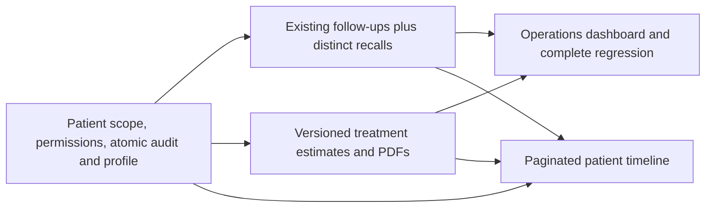

# Phase 2 implementation plan and execution record

Status: **approved and implemented**. Date: 2026-10-24. Read with [reference UI analysis](reference-ui-analysis.md), [source audit](existing-feature-audit.md) and [final implementation report](final-implementation-report.md).

After the reference audit and plan were presented, the user authorized all checkpoints: “Yes, Please now implement it. everything mentioned in the prompt don't take approval now.” This supersedes the checkpoint-by-checkpoint approval requests in the original planning text below. Work proceeded A → B → C → D, with backend checks during each checkpoint and integrated browser/Docker validation at D. No production deployment, real communication or Phase 3 work was authorized or performed. The remainder retains the original specification; final behavior and evidence are in the implementation report and test results.

## Scope and dependency map

Retain the canonical Patient, existing FollowUp, shared appointment service, existing shell and Retell contracts. Develop original components using existing Tailwind/theme conventions. Never port reference code or module schemas. Exclude clinical charts/notes, prescriptions, billing/payment/invoice implementation, payroll, inventory, signatures claiming legal effect and outbound campaigns.

## Checkpoint A — patient administration and timeline

### Deliverable behavior

A bounded, server-filtered directory supports name/contact search, active/archived filters, allowlisted registration/name/last-visit sorting, previous/next page, add/view/edit and explicit archive/restore. Display contact preference, status, registration and last/next appointment from batched aggregates. Reuse the existing create API and preserve the list's `items` wrapper. Migrate both directory and appointment patient picker to paginated search so adding pagination cannot hide booking candidates.

Open a patient profile within the existing dashboard shell using a URL-addressable selection (e.g. `/dashboard?section=patients&patient=ID`). Include identity header and Overview, Appointments, Communications, Follow-ups, Estimates, Insurance and Timeline tabs. Tabs for later checkpoints are shown only once their functional module exists; no placeholder action buttons. Overview shows actual next/recent completed appointment and open follow-up counts. Preserve existing appointment actions by deep-linking into their current section. Never link communications by matching phone/name: only explicit verified patient associations qualify.

Edit uses labeled fields and backend validation, including optional DOB (no future date), administrative status and contact opt-out. Insurance intake requires the explicitly selected patient and shows that patient's existing policies. Confirmation is required before archive or restore. Archive does not erase history or automatically cancel appointments. UI handles initial/loading, empty, validation, conflict, forbidden and failed-request states; forms have focus/error handling and responsive layout.

### Data and service changes

- Extend Patient additively: nullable DOB, active/archived status with existing rows active, do_not_contact default false (not evidence of consent), archived_at/archived_by, updated_at and optimistic revision. Do not create a new patient identity or match/merge by name/contact.
- Add clinic_id and optional patient_id to AuditLog for new events, nullable for legacy records. Preserve old events; do not invent missing actor/history. Fix patient/insurance writes to commit domain change and audit atomically with the authenticated actor. Record changed field names and safe event summaries, not full private field values.
- Add patient detail/related-record and cursor timeline services. Timeline combines real registration, appointment/audit, explicitly linked calls and follow-ups; later modules append their actual events. Deduplicate an audited appointment event against its source fallback. Stable ordering uses UTC timestamp plus event type/source ID. Paginate in SQL/UNION or indexed event query; do not load full histories in Python before slicing.
- Introduce a Phase 2 patient migration after the existing Phase 1 revision, with indexes for clinic/status/created/name and patient/event/time access. Rehearse fresh and existing Phase 1 schemas, including representative synthetic records and old null audit context. Do not rewrite the historical baseline to add new schema implicitly.

### Explicit contract and authorization changes for approval

Existing patient GET/POST/PATCH and insurance paths remain. Add bounded page/page_size (default 25, maximum 100), total and sort/filter metadata to lists; keep existing item fields. New detail fields are additive. Write payloads use an expected revision to detect lost edits (409); document any transitional compatibility for existing callers.

DELETE currently hard-deletes. Do **not** remap it to archive. Proposed safety contract: retain owner-only hard deletion for an unreferenced record, return 409 when referenced, and add separately named archive/restore actions for ordinary administrative lifecycle. No automated retention purge is added. This proposal requires approval as part of Checkpoint A because no clinic retention policy was supplied.

Granular patient permissions replace implicit “any authenticated clinic member” access for these routes. Proposed grants: owner patient read/write/archive/delete; receptionist read/write/archive; dentist read and contact/profile updates only if the clinic approves patient_write; scheduler read only. Conservative initial matrix leaves dentist writes off. All grants and frontend capability responses are documented; existing schedule permissions remain. Financial values never appear in the patient directory/profile without an estimate/financial permission. Later estimate summary counts must obey the same permission boundary.

### Checkpoint A gate

Run existing backend suite plus patient pagination/search/filter, selected-patient insurance, DOB/update/clear-field validation, atomic audit rollback, optimistic update conflict, archive/restore/referenced-delete, related-record clinic isolation and timeline ordering/dedup/pagination tests. Run PostgreSQL migration tests on isolated databases. Browser tests demonstrate directory → profile → edit → insurance → appointment/communication → timeline and authorized/forbidden/empty/error states at desktop and mobile sizes. Re-run booking/Retell regressions and production frontend build. Present changed files, API/migration differences and actual results before Checkpoint B.

## Checkpoint B — follow-ups and recalls

Extend FollowUp with due_at, extensible type, appointment/call/estimate links where available, creator/update/completion/cancellation metadata and revision. Keep unverified callback patient_id optional. Extract a shared follow-up service; existing operations routes and Retell callback adapter use it without changing the voice function contract or weakening idempotency. Validate assigned staff as an active membership of the same clinic. Proposed lifecycle: pending → in_progress/completed/cancelled; in_progress → completed/cancelled; terminal states require an explicit owner reopen action if included in approved scope, never arbitrary patching.

Introduce a distinct Recall for a future visit, with patient, manually selected due date, reason/type, staff, optional completed-origin appointment, contact preference, last attempt, scheduled appointment and completion metadata. Proposed lifecycle: due → contact_pending → contacted → scheduled → completed, with explicit cancellation and carefully specified retry transitions. “Scheduled” must point to a same-patient active appointment; “completed” must be validated against an actual completed appointment or an authorized administrative reason. No universal recall interval or LLM-generated clinical date. Optional clinic-approved interval rules remain disabled unless configured and attributed to an approving staff member.

Provide two complete filterable/paginated workspaces, create/edit/detail forms, assignment, due/overdue badges, status confirmations and patient/appointment/call links. Due-today/overdue uses clinic timezone boundaries; completion state is independent of reminder delivery. One manual contact-attempt record may be logged without actually initiating a call/message.

Contact preference is not consent. Add channel consent/opt-out configuration with do_not_contact overriding automated outreach. Background processing may prepare sandbox reminder records only, rechecking current scope, status and opt-out each run. Use the existing worker and durable DB uniqueness for clinic/entity/version/channel/due-window; Redis is coordination, not the sole deduplication store. Record prepared/skipped/failed outcomes, never sent without a transport delivery acknowledgement. No real email/SMS/WhatsApp integration or campaigns.

Gate: typed workflow/assignment/opt-out/due-zone tests, duplicate Retell callbacks and duplicate concurrent reminder preparation on PostgreSQL, real browser CRUD/filter/complete flows, baseline regressions and migration/build checks. Demonstrate before proceeding.

## Checkpoint C — estimates and protected PDFs

Add clinic estimate policy, TreatmentEstimate, immutable EstimateVersion, version-owned EstimateItem snapshots, EstimateStatusHistory and version-specific EstimateAcknowledgement. Reuse canonical Patient/Clinic/Service/Staff. Monetary storage uses Numeric and Python Decimal; API money values are decimal strings. Legacy catalog float must be bridged to a reviewed canonical Numeric price source; keep existing indicative_price contract while new estimates snapshot decimal price/name/description/currency/tax policy. Never silently change past estimates after a catalog edit.

Policy configuration controls currency precision, approved tax rates/labels, rounding, allowed discounts/caps, validity and terms; no invented tax IDs/rates/addresses. Until policy is configured, show setup-required rather than issuing a quote with fabricated settings. Proposed calculation: quantity × unit price; permitted line discount; tax on discounted base; round each line's monetary components with configured precision and ROUND_HALF_UP; sum persisted rounded lines for header totals. Validate quantities/rates/discount bounds/currency consistency and finite decimal inputs. Specific tax/discount order and rounding require review before this checkpoint is approved.

Proposed states: draft → sent → accepted/declined/expired; allow explicit cancellation for draft/sent. Mark sent means staff recorded delivery outside the application (requires delivery method/time confirmation), never that email was actually sent. No automated expiry policy is activated before validity rules are configured. Accepted/declined acknowledgement records exact version, actor, patient/representative name, method and time; it is administrative evidence, not a claimed legal e-signature. Sent/accepted version content is immutable. Revisions require reason/permission, create a new draft and leave prior content/acknowledgement unchanged. Use expected_revision + row locking; two simultaneous edits cannot silently overwrite.

Build estimate list/detail, item editor, server preview/totals, draft edit, duplicate-to-draft, revision, history, record-delivery/acceptance/decline dialogs and PDF download. Patient profile shows authorized estimates only. PDFs use trusted clinic information and stored version snapshots, Unicode fonts, wrapping/page breaks, number/status/version/validity/currency/terms, with protected authorized downloads and no public patient tokens. Use a small server PDF library (proposed ReportLab), with render/text/visual verification. No signed-document imitation or invoice creation.

Gate: decimal edge/property cases, policy/tax/discount validation, version invariance, approval and PDF authorization, cross-clinic links, real PostgreSQL concurrent updates, PDF text/render checks, complete browser estimate flow and all regressions/builds. Demonstrate before Checkpoint D.

## Checkpoint D — operations and complete acceptance

Add clinic-scoped real counts for active/new patients, open/due-today/overdue follow-ups, due recalls, draft/sent/accepted/declined estimates. Exclude financial amounts and sensitive estimate-derived data without the required permission. Preserve existing scheduling/call metrics. Dashboard cards deep-link to matching server filters; define each metric's time window and clinic timezone. No unnecessary charts.

Complete profile module integration, query/index review and bounded request tests, access checks on every list/detail/mutation/history/PDF/export, mobile/keyboard/error/empty browser coverage, complete pytest/real PostgreSQL and Playwright regressions, PDF rendering and production Docker/Compose/runtime checks. Use disposable data only; no production reset, migration execution or deployment. Preserve explicit Phase 1 security/live acceptance limitations.

Publish the remaining requested docs under docs/phase-2: data-model-changes, api-contracts, frontend-components, permissions-and-security, test-results, deployment-notes and final-implementation-report. Do not pre-label these as implemented before actual code/testing. Report unexecuted/unverified items explicitly.

## Proposed implementation locations

| Layer | Extend | Add where needed |
|---|---|---|
| Models | `apps/api/app/models/models.py` | Separate phase2 model module only if it improves readability and is registered with Alembic |
| Migrations | new revisions after Phase 1 | one additive revision per checkpoint; compatibility tests |
| Schemas | `app/schemas/patient.py` | follow_up.py, recall.py, estimate.py |
| Shared services | audit.py and existing Retell adapter | patients.py, follow_ups.py, recalls.py, estimates.py, estimate_pdf.py, reminder_preparation.py |
| Routes | patients.py, operations.py, dashboard.py | recalls.py, estimates.py; register within existing authenticated main.py routing |
| Frontend | existing dashboard page, insurance/booking patient selection | focused patient/profile/timeline, follow-up/recall, estimate components under existing features/components folders |
| Verification | existing pytest and Playwright tools | checkpoint-specific API/migration/PostgreSQL/browser tests and PDF QA |
| Deployment | existing Docker/Compose/worker | only necessary PDF dependency/fonts and documented sandbox preparation settings |

## Authorization boundary

All Phase 2 code, migrations, tests and local synthetic verification are authorized by the user's latest instruction. Live messages, live Retell changes, major frontend stack migration, inferred clinical recall intervals and legally binding signatures remain outside scope. Original proposal wording below is historical; no further checkpoint approval is pending.

## Checkpoint A API outline to review

| Endpoint | Purpose / contract |
|---|---|
| `GET /api/v1/patients` | Preserve items; add total/page/page_size and bounded search/status/date/sort filters. Summaries use batch aggregates. |
| Existing `POST/PATCH /api/v1/patients[/{id}]` | Reuse identity schemas, add optional DOB/contact opt-out and revision; explicit fields_set handling allows clearing optional data. Atomic audit. |
| `GET /api/v1/patients/{id}/profile` | Lightweight overview; no entire history or unauthorized financial data. |
| `GET /api/v1/patients/{id}/appointments` | Bounded same-clinic/same-patient appointments with existing scheduling links. |
| `GET /api/v1/patients/{id}/communications` | Bounded explicitly associated calls only; no transcripts by default. |
| `GET /api/v1/patients/{id}/follow-ups` | Bounded existing callback records; expanded by B. |
| `GET /api/v1/patients/{id}/timeline` | Cursor + limit, stable chronological events, source/actor/related identifier and minimal summary. |
| `POST /api/v1/patients/{id}/archive` / `restore` | Expected revision and explicit confirmation; reversible administrative state, never a retention purge. |
| Existing `DELETE /api/v1/patients/{id}` | Proposed owner-only, unreferenced-record deletion; 409 for retained relationships. Not an archive alias. |
| Existing patient insurance GET/POST | Explicit selected patient, same clinic, dedicated patient read/write checks and atomic audit. |

Archived profiles/history remain readable to authorized staff; archive does not mutate existing appointment lifecycle. New bookings, estimates and automatic recall outreach for an archived patient should require restoration, while cancellation/administrative completion of an existing appointment remains possible. This is a proposed business rule to approve, not existing behavior. No automated data erasure or minimum retention duration is assumed.
